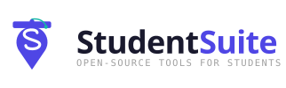

<picture>
  <source media="(prefers-color-scheme: dark)" srcset="./logo-lockup-dark.svg">
  
</picture>

# Awesome SAT Resources

A curated list of the best practice tests, question banks, video lessons, vocab, and communities for the SAT.

---

This is a curation list, not a code library. Every entry links out to a tool, channel, or course maintained by someone else, not to something hosted here. Found a great SAT resource that is missing? Add it by opening a PR, see [CONTRIBUTING.md](CONTRIBUTING.md).

This list goes deep on one exam. [Awesome Study Resources](https://github.com/StudentSuite/awesome-study-resources) covers exam, curriculum, and subject-specific material across many exams, [Awesome Student Resources](https://github.com/StudentSuite/awesome-student-resources) covers life around school (discounts, money, career prep, and wellbeing), and [Awesome Skills & Plugins for Students](https://github.com/StudentSuite/awesome-skills-plugins-for-students) covers AI coding-agent skills and plugins built for students. They stay separate so each list stays focused enough to be useful.

> Every entry carries a tag badge (free, freemium, or paid, plus FOSS where it applies), so you know before you click. Resources within each list are ordered alphabetically. See the [Quality Standards](#quality-standards) for what earns a spot.
>
> Maintained by [StudentSuite](https://github.com/StudentSuite) &middot; [Report a broken link](https://github.com/StudentSuite/awesome-sat-resources/issues/new/choose) &middot; [Ask a question](https://github.com/StudentSuite/awesome-sat-resources/discussions) &middot; [Changelog](CHANGELOG.md)

---

## Table of Contents

| Icon | Section | Resources |
| :-: | --- | :-: |
| 🏛️ | [Official Resources](#official-resources) | 1 |
| ⏱️ | [Mock Tests & Full-Length Practice](#mock-tests--full-length-practice) | 8 |
| ✏️ | [Practice Questions & Quizzes](#practice-questions--quizzes) | 7 |
| 🎬 | [Video Lessons & YouTube](#video-lessons--youtube) | 10 |
| 👥 | [Communities](#communities) | 5 |
| 🔤 | [Vocab Bank](#vocab-bank) | 4 |

[More from StudentSuite](#more-from-studentsuite) &middot; [Sister lists](#sister-lists) &middot; [A Note on Links](#a-note-on-links) &middot; [Quality Standards](#quality-standards) &middot; [Contributing](#contributing) &middot; [Contributors](#contributors) &middot; [License](#license)

> Looking for quiet study spots or exam locations? [StudyMap](https://github.com/StudentSuite/StudyMap) is a crowdsourced map of student-important places like libraries and exam centres.

---

## Official Resources

Straight from the College Board, the people who write the exam: dates, registration, and score info.

Official Resources

- **[College Board SAT Suite](https://satsuite.collegeboard.org/sat)** - The official overview, dates, registration, and score info for the SAT .

---

## Mock Tests & Full-Length Practice

Timed, full-length practice tests for building stamina and getting a realistic score estimate before test day.

Mock Tests &amp; Full-Length Practice

- **[1600.now](https://1600.now/)** - Practice SAT questions and timed tests with answer explanations .
- **[College Board Bluebook](https://bluebook.collegeboard.org)** - The official app that delivers full-length adaptive practice tests .
- **[College Board SAT Practice](https://satsuite.collegeboard.org/practice)** - Take official SAT practice tests and review sample questions .
- **[Kaplan SAT](https://www.kaptest.com/sat/free/sat-practice)** - Take a full-length Digital SAT practice test with a score report .
- **[Mometrix SAT](https://www.mometrix.com/academy/sat-practice-test/)** - Take a Digital SAT practice test with Reading, Writing, and Math questions .
- **[Test Innovators](https://testinnovators.com/sat/digital-sat-practice/)** - Take adaptive Digital SAT practice tests with detailed score analytics .
- **[The Princeton Review SAT](https://www.princetonreview.com/college/free-digitalsat-practice-test)** - Take a full-length Digital SAT practice test with a score report .
- **[Varsity Tutors SAT](https://www.varsitytutors.com/practice/subjects/sat/practice-tests)** - Take timed Digital SAT practice tests with immediate scoring .

---

## Practice Questions & Quizzes

Question banks and short quizzes for drilling one skill at a time.

Practice Questions &amp; Quizzes

- **[Albert SAT](https://www.albert.io/sat)** - Digital SAT question bank with practice exams .
- **[College Board Student Question Bank](https://satsuite.collegeboard.org/practice/student-question-bank)** - Filter thousands of official questions by section, skill, and difficulty .
- **[High School Test Prep SAT](https://highschooltestprep.com/sat/)** - Practice SAT reading, writing, and math questions with explanations .
- **[Khan Academy Official Digital SAT](https://www.khanacademy.org/digital-sat)** - Free official Digital SAT practice, made with College Board .
- **[Test Ninjas](https://test-ninjas.com/free-sat-practice)** - Get daily SAT questions, a practice test, and study guides .
- **[Union Test Prep SAT](https://uniontestprep.com/sat-exam)** - Practice SAT questions with lessons, flashcards, and study guides .
- **[UWorld SAT](https://collegeprep.uworld.com/sat/)** - Large question bank with detailed explanations .

---

## Video Lessons & YouTube

Hand-picked video explanations, grouped by subject.

### English

English

- **[Acing SAT English so you can just copy me](https://youtu.be/ZOz81HrniRA)** - A perfect scorer solves a full Bluebook English section live, narrating the approach .
- **[All of SAT Grammar in 37 Minutes (2026)](https://youtu.be/iJVJnvZO3PM)** - Every Digital SAT grammar rule in one sitting .
- **[All of SAT Passage Questions in 21 Minutes](https://youtu.be/0-cDbAjF5o8)** - Every SAT reading passage question type, covered fast .
- **[Digital SAT: Cross-Text Connections (FULL GUIDE)](https://youtu.be/yfn_VRLG5rg)** - Full strategy walkthrough for cross-text connection questions .
- **[English SAT Hacks | Structure & Purpose](https://youtu.be/fAHc6HnySgE)** - Hacks for structure-and-purpose questions .
- **[The "Ingredients" Trick for SAT Graph Questions](https://youtu.be/bAlMc1XiCpA)** - A trick for reading and answering SAT graph questions .
- **["Though" and "However" on the SAT? You're Missing This](https://youtu.be/s27u0NH2cWM)** - Strategy for transition-word questions built around "though" and "however" .

### Math

Math

- **[8 Advanced Desmos Hacks You NEED for the SAT](https://youtu.be/eIkiuHw9nrI)** - Desmos calculator tricks for the Digital SAT math section .
- **[EVERY SAT DESMOS HACK in Under 6 Minutes (2026)](https://youtu.be/ZcsaatYhHTM)** - Every Desmos calculator hack for the Digital SAT, fast .

### General

General

- **[EVERYTHING You Need to Know about the SAT (2026)](https://youtu.be/9IC3WMCAAwc)** - A full intro to the Digital SAT: format, sections, and scoring .

---

## Communities

Places to ask questions, compare scores, and swap strategies with other test-takers.

Communities

- **[College Confidential SAT Preparation](https://talk.collegeconfidential.com/c/sat-and-act-tests-test-preparation/sat-preparation/64)** - Ask SAT prep questions and read advice threads on a college-admissions forum .
- **[Quora SAT](https://www.quora.com/topic/SAT-Exam)** - Read and ask questions in Quora's SAT topic .
- **[r/ApplyingToCollege](https://www.reddit.com/r/ApplyingToCollege/)** - Discuss SAT scores and strategy inside the broader college-admissions community .
- **[r/digitalSATs](https://www.reddit.com/r/digitalSATs/)** - Swap strategies and practice resources for the digital SAT .
- **[r/SAT](https://www.reddit.com/r/SAT/)** - Strategy, practice, and score discussion for the SAT .

---

## Vocab Bank

Word lists, flashcards, and vocab builders for the reading and writing sections.

Vocab Bank

- **[Magoosh SAT Vocabulary Flashcards](https://magoosh.com/hs/sat/sat-vocabulary-flashcards/)** - Study a free deck of high-frequency SAT vocab flashcards .
- **[Membean](https://www.membean.com/)** - Build vocabulary long-term with adaptive, spaced-repetition word training .
- **[Quizlet SAT Vocabulary](https://quizlet.com/subject/sat-vocabulary/)** - Drill SAT vocab with community-made flashcard sets .
- **[Vocabulary.com SAT Word Lists](https://www.vocabulary.com/lists/)** - Learn SAT-level words with adaptive games and lists .

---

## More from StudentSuite

- **[Awesome Skills & Plugins for Students](https://github.com/StudentSuite/awesome-skills-plugins-for-students)** - Curated AI coding-agent skills and plugins built for students .
- **[Awesome Student Resources](https://github.com/StudentSuite/awesome-student-resources)** - Curated software, tools, and resources for life around school .
- **[Awesome Study Resources](https://github.com/StudentSuite/awesome-study-resources)** - Curated exam, curriculum, and subject-study resources for students .
- **[StudyMap](https://github.com/StudentSuite/StudyMap)** - A crowdsourced map of student-important places: exam centres, libraries, and more .

---

## Sister lists

- [awesome-student-resources](https://github.com/StudentSuite/awesome-student-resources) - Discounts, money, career prep, and wellbeing.
- [awesome-study-resources](https://github.com/StudentSuite/awesome-study-resources) - Exam and subject study material.
- [awesome-skills-plugins-for-students](https://github.com/StudentSuite/awesome-skills-plugins-for-students) - AI coding agent skills and plugins.

---

## A Note on Links

> [!NOTE]
> This list points to third-party tools, channels, and courses. StudentSuite does not own, host, or endorse them, except its own projects (StudyMap and the sister lists), and it earns nothing from these links. Pricing and free tiers change, and the SAT itself changes (it is now a digital, adaptive test), so check the current terms and format before you commit. If a listed entry is dead, outdated, misleading, or no longer free where we said so, open an issue or PR to fix it.

---

## Quality Standards

An entry should meet all of the following before being added:

- **Genuinely useful for SAT prep.** It helps you learn, practice, or plan for the SAT, not just browse.
- **Current.** Reflects the digital SAT, not abandoned or a dead link.
- **Accessible.** Free, freemium, or clearly worth the price; tagged with exactly one pricing badge (plus FOSS where it applies).
- **Reputable.** A known tool, channel, or course, not spam or an affiliate funnel.
- **Short description.** One line, plain language, no marketing copy.

---

## Contributing

PRs adding a resource are welcome. See [CONTRIBUTING.md](CONTRIBUTING.md) for the entry format and PR checklist, and the [Code of Conduct](CODE_OF_CONDUCT.md) for how we expect people to treat each other here. See [CHANGELOG.md](CHANGELOG.md) for release history.

---

## Contributors

Thanks to everyone who has added a resource, fixed a link, or improved the format.

Recognized contributions, including non-code ones (bug reports, docs, ideas), via [all-contributors](https://allcontributors.org):

<!-- ALL-CONTRIBUTORS-LIST:START - Do not remove or modify this section -->
<!-- prettier-ignore-start -->
<!-- markdownlint-disable -->
<table>
  <tbody>
    <tr>
      <td align="center" valign="top" width="14.28%"><a href="https://github.com/yakew7"> <b>Yash Kewlani</b></a> <a href="#content-yakew7" title="Content">🖋</a> <a href="https://github.com/StudentSuite/awesome-sat-resources/commits?author=yakew7" title="Documentation">📖</a> <a href="#maintenance-yakew7" title="Maintenance">🚧</a> <a href="https://github.com/StudentSuite/awesome-sat-resources/pulls?q=is%3Apr+reviewed-by%3Ayakew7" title="Reviewed Pull Requests">👀</a> <a href="#infra-yakew7" title="Infrastructure (Hosting, Build-Tools, etc)">🚇</a></td>
      <td align="center" valign="top" width="14.28%"><a href="https://github.com/AnayDhawan"> <b>Anay Dhawan</b></a> <a href="#content-AnayDhawan" title="Content">🖋</a> <a href="https://github.com/StudentSuite/awesome-sat-resources/commits?author=AnayDhawan" title="Documentation">📖</a> <a href="#maintenance-AnayDhawan" title="Maintenance">🚧</a> <a href="https://github.com/StudentSuite/awesome-sat-resources/pulls?q=is%3Apr+reviewed-by%3AAnayDhawan" title="Reviewed Pull Requests">👀</a> <a href="#infra-AnayDhawan" title="Infrastructure (Hosting, Build-Tools, etc)">🚇</a></td>
    </tr>
  </tbody>
</table>

<!-- markdownlint-restore -->
<!-- prettier-ignore-end -->

<!-- ALL-CONTRIBUTORS-LIST:END -->

---

## License

This repository is released under the [MIT License](LICENSE). The license covers this list itself: the README, CONTRIBUTING.md, and curation structure. It does not cover the tools, channels, or courses linked from it, each of those is owned and licensed by its own author.
